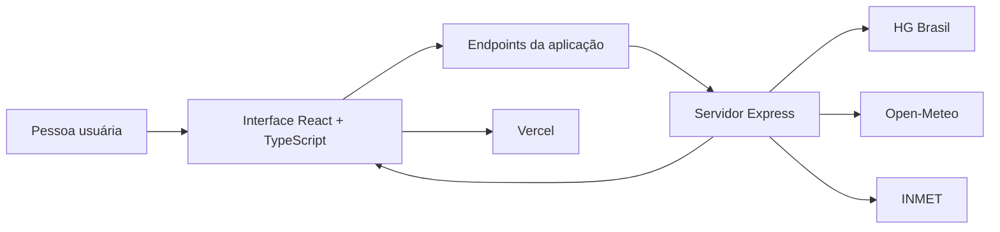
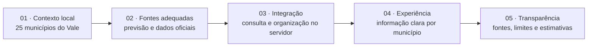

# Tempo no Taquari

Aplicação web de previsão do tempo para **25 municípios do Vale do Taquari**, no Rio Grande do Sul. O projeto combina previsões, alertas oficiais e indicadores relacionados ao clima em uma interface pensada para o contexto local.

> **Publicado na Vercel.** O README apresenta a proposta, as tecnologias, as decisões de implementação e os próximos passos do projeto — não é um guia para instalação ou contribuição.

## A proposta

A ideia é tornar informações meteorológicas de diferentes fontes mais fáceis de consultar e úteis para quem vive ou acompanha o Vale do Taquari. Em vez de mostrar apenas a temperatura, a aplicação reúne previsões, dados ambientais, alertas e estimativas para o cotidiano.

A navegação é organizada em cinco áreas:

- **Painel** — condições atuais e indicadores selecionados.
- **Previsão** — previsão por hora e para os próximos dias.
- **Astronomia** — informações como fase da Lua e eventos astronômicos.
- **Agro** — área dedicada a temas meteorológicos e ambientais relevantes ao campo.
- **Sobre** — apresentação do projeto, fontes, limitações, novidades e contato.

A cidade pode ser escolhida entre os 25 municípios atendidos, e a preferência fica salva no navegador.

## Tecnologias

| Tecnologia | Uso no projeto |
| --- | --- |
| [React](https://react.dev/) | Construção da interface em componentes. |
| [TypeScript](https://www.typescriptlang.org/) | Tipagem estática da aplicação. |
| [Vite](https://vite.dev/) | Servidor de desenvolvimento e build do frontend. |
| [Express](https://expressjs.com/) | Servidor e endpoints que consultam fontes externas. |
| [Axios](https://axios-http.com/) | Requisições HTTP. |
| [SunCalc](https://github.com/mourner/suncalc) | Cálculos de posição solar usados em estimativas. |
| [Vercel](https://vercel.com/) | Publicação do projeto. |
| CSS | Estilos e adaptação da interface a diferentes telas. |

## Arquitetura

A interface consulta endpoints da aplicação. O servidor valida o município, consulta os serviços externos e entrega os dados necessários ao frontend. A chave da HG Brasil é mantida no servidor, sem ser incluída no código enviado ao navegador.

A aplicação também usa cache nos endpoints compatíveis e limita o volume de requisições ao servidor. Os alertas do INMET são filtrados para o município selecionado; os dados disponibilizados pela API são armazenados em cache por 10 minutos.

## Minha abordagem

O desenvolvimento parte de uma pergunta prática: **como transformar dados meteorológicos de fontes diferentes em informações locais compreensíveis, sem esconder de onde vêm ou o que significam?**

Na prática, isso orienta algumas decisões do projeto:

- **Contextualizar:** relacionar os dados à cidade selecionada e à região.
- **Separar responsabilidades:** manter integrações e credenciais no servidor, e a apresentação dos dados na interface.
- **Explicar as estimativas:** deixar claro quando um indicador é calculado e não uma observação ou alerta oficial.
- **Priorizar fontes e cobertura:** novas informações regionais dependem de fontes confiáveis e de dados adequados para os municípios atendidos.

## Fontes de dados e créditos

- [HG Brasil](https://hgbrasil.com/status/weather) — condições atuais e previsão do tempo.
- [Open-Meteo](https://open-meteo.com/) — previsão horária e dados complementares, incluindo qualidade do ar, índice UV, ponto de orvalho e radiação solar.
- [CAMS](https://atmosphere.copernicus.eu/) — fonte dos dados de qualidade do ar disponibilizados pelo Open-Meteo.
- [INMET](https://portal.inmet.gov.br/) — avisos meteorológicos oficiais.
- [EXOSS](https://press.exoss.org/calendario/) — referência para o calendário de chuvas de meteoros.
- [Meteocons](https://bas.dev/work/meteocons) — ícones meteorológicos SVG de Bas Milius.
- [SunCalc](https://github.com/mourner/suncalc) — biblioteca usada em cálculos relacionados à posição solar.

## Funcionalidades implementadas

- Previsão para os 25 municípios atendidos.
- Condições atuais, previsão horária e previsão estendida.
- Alertas do INMET associados ao município selecionado.
- Qualidade do ar, índice UV e estimativa de potencial solar.
- Indicadores para o cotidiano, como condições para secagem de roupas.
- Informações de astronomia, incluindo fase da Lua e chuvas de meteoros.
- Feriados nacionais e estaduais e datas municipais disponíveis.
- Estimativas apresentadas com contexto e ressalvas.
- Interface responsiva e escolha de unidades de medida.

## Roadmap

Os itens abaixo representam possibilidades em estudo, não compromissos com prazo. A inclusão depende da disponibilidade, cobertura e confiabilidade das fontes de dados.

### Dados regionais e ambientais

- [ ] Avaliar dados do nível do Rio Taquari em estações oficiais identificadas, mostrando estação e distância quando houver cobertura adequada.
- [ ] Integrar chuva observada em estações próximas para complementar a previsão.
- [ ] Investigar fontes e metodologias oficiais para apresentar condições de estiagem.
- [ ] Avaliar dados do INPE sobre risco meteorológico de fogo, distinguindo risco de focos de calor detectados por satélite.

### Agro

- [ ] Avaliar fontes de dados meteorológicos e ambientais relevantes para a seção Agro.

### Melhorias técnicas

- [ ] Avaliar uma estratégia de persistência temporária dos dados para reduzir consultas repetidas às fontes externas.

### Saúde

- [ ] Reavaliar a inclusão do nível de pólen e de uma explicação adequada para esse indicador.

## Transparência e limitações

As informações dependem da disponibilidade e da atualização das fontes externas. O horário mostrado pela aplicação corresponde à consulta concluída pelo servidor e não necessariamente ao instante em que a condição meteorológica foi observada.

Alguns recursos são **estimativas**, não confirmações de fenômenos. Por exemplo, a indicação de possibilidade de arco-íris combina precipitação e nebulosidade previstas pelo Open-Meteo com a elevação solar calculada pelo SunCalc. Ela não confirma que um arco-íris será observado.

A aplicação procura distinguir dados de previsão, avisos oficiais e indicadores calculados. Mais detalhes sobre fontes, critérios e limitações também estão disponíveis na seção **Sobre** do site.

## Publicação

O projeto está publicado na [Vercel](https://vercel.com/). A chave da HG Brasil é configurada como variável de ambiente no servidor e não deve ser exposta no frontend.
